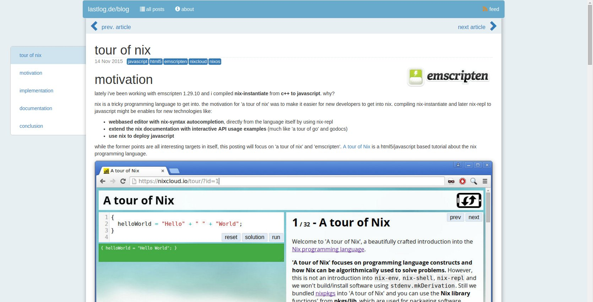
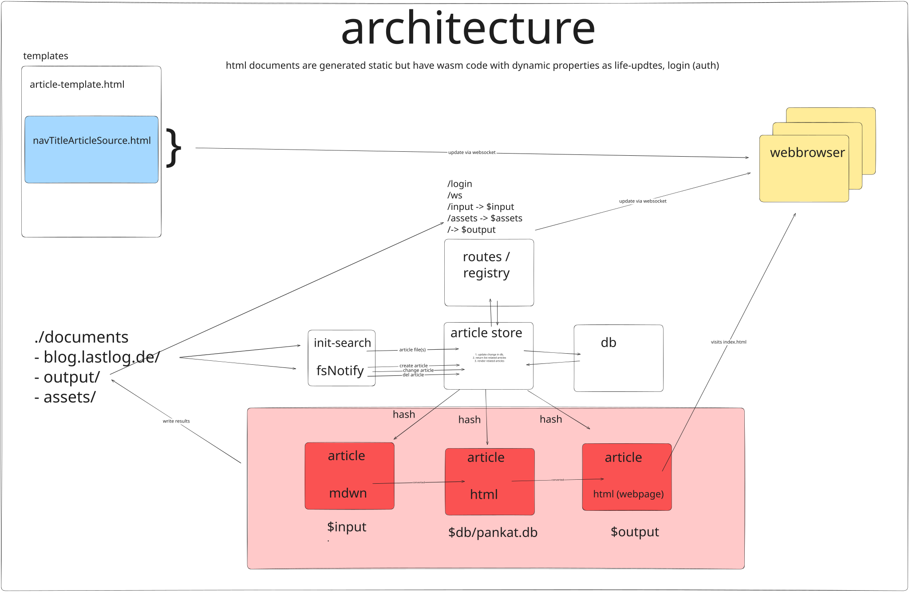

# what

**pankat** is a **static blog generator** with a live preview: it renders markdown articles to
static html, which nginx (or pankat itself) serves, and while you write, pankat watches the
documents folder and updates open browser tabs via websocket.



# features

* writing
  * **markdown** articles (`*.mdwn`), rendered with **pandoc 3.x**
  * **plugins** in the articles for metadata, images, drafts, ... (see [plugins](#plugins))
  * **live updates**: a file system watcher (inotify) rebuilds changed articles and pushes the
    new html to all open browser tabs via websocket
    * neighbouring articles (prev/next, series) and the timeline are rebuilt as well
    * renaming an article shows readers of the old page a link to the new location, removing
      it a link to the blog's index
    * removing a plugin call (e.g. `[[!series ...]]`) removes its effect again
  * **drafts** (`[[!draft]]`) are only visible to the admin, rendered on request and never
    written to the public output
  * documents are plain files, manage them with **git**
* reading
  * **table of contents** (jquery.tocify) and **page anchors** for headings
  * **timeline** of all articles with a **tag** and **series** filter
  * **prev/next** navigation and **series** navigation
  * the index redirects to the most recent article
  * **Open Graph / twitter card** tags for social previews (title, summary, image, tags)
  * a **404 page** in the look of the blog
* admin
  * a single user, the admin: `/login` asks for the `admin_password` only
  * `/drafts/` lists all drafts newest first, `/specialpages/` all special pages
  * the session lasts 50 days (http-only cookie with a JWT signed by `jwt_token`)
* minimalistic
  * the output is **static html**, hosted with **nginx** in production
  * **sqlite** database with a cache of the pandoc output
  * **incremental builds**: a startup only does what changed (see [rebuilds](#rebuilds))
  * **out of source** builds: input, output, assets and database are separate directories
  * stale files in the output directory are removed on startup
  * all templates and pandoc filters are checked on startup, a missing or broken one stops
    pankat with a list of all problems instead of failing in the middle of a build
* full **theme support**, the assets folder contains
  * templates (handlebars)
  * css
  * js
  * fonts
  * pandoc lua filters

# plugins

plugins are written as `[[!name argument]]` into an article, names are case insensitive.

| plugin | example | effect |
|---|---|---|
| `meta` | `[[!meta date="2026-10-12 12:00"]]` | date of the article, orders the timeline and prev/next |
| `title` | `[[!title my article]]` | title, defaults to the file name |
| `summary` | `[[!summary one sentence about it]]` | shown in the timeline and as social preview description |
| `tag` | `[[!tag nix rust]]` | tags, whitespace separated |
| `series` | `[[!series libnix]]` | adds the article to a series with its own navigation |
| `img` | `[[!img media/logo.png class="noFancy" style="float: right"]]` | image linking to itself, further attributes are passed on |
| `draft` | `[[!draft]]` | only the admin can see the article below `/drafts/` |
| `SpecialPage` | `[[!SpecialPage]]` | a page like about or imprint: not in the timeline, no prev/next |
| `OpenGraphImage` | `[[!OpenGraphImage posts/libnix/card.png]]` | image for social previews, without it a small card is used |
| `hiddentext` | `[[!hiddentext the solution]]` | text hidden behind a "show" toggle |

# run

    nix develop
    cargo build
    cargo run

then open http://localhost:5000 (see `port` and `subdir` in [pankat.toml](pankat.toml)).

`just run` additionally builds the wasm client first, see below for what builds where.

## building

`nix develop` provides **cargo+libnix**, a cargo which builds every crate as its own nix
derivation (`CARGO_BACKEND=nix` is set in the dev shell). at the moment it can build and test the main
webserver, but not the static musl binary of `just zig` nor `pankat-wasm`.

| what | command | with cargo+libnix |
|---|---|---|
| webserver | `cargo build` | yes |
| webserver as nix package | `nix build .#pankat` | yes |
| tests | `cargo test` | yes (since cargo+libnix v4) |
| static musl binary for deployment | `just zig` | no, not at the moment |
| wasm client (live updates in the browser) | `just build-pankat-wasm copy-pankat-wasm` | no, not at the moment |

`CARGO_BACKEND=legacy` switches to the regular cargo behaviour. the wasm client ends up in
`documents/wasm`, pankat serves it from the `wasm` directory.

## configuration

pankat reads, in this order (later ones win):

* defaults of the **command line** options (see `pankat --help`)
* the config file **`pankat.toml`** in the working directory, documented in
  [pankat.toml](pankat.toml)
* **environment variables** `PANKAT_<OPTION>`, e.g. `PANKAT_JWT_TOKEN`,
  `PANKAT_ADMIN_PASSWORD` or `PANKAT_SITE_URL`; use these for the secrets
* **command line** options which were set explicitly

| option | meaning |
|---|---|
| `input` | the documents (`*.mdwn`, `posts/`, `media/`) |
| `output` | generated html, can be deleted and regenerated |
| `assets` | templates, css, js, fonts, pandoc lua filters |
| `wasm` | the wasm client |
| `database` | directory of `pankat.sqlite` |
| `site_url` | public URL incl. subdir, e.g. `https://lastlog.de/blog`, for the label top left and the social previews |
| `subdir` | path the blog lives below, e.g. `/blog` or `""` |
| `port` | port of the webserver |
| `flat` | `documents/mydir/myarticle.mdwn` becomes `output/myarticle.html` instead of `output/mydir/myarticle.html` |
| `static_build_only` | only build the documents and exit |
| `jwt_token` | server side secret signing the session cookies, changing it logs out all sessions |
| `admin_password` | password of the admin for `/login` |

the login is disabled while `jwt_token` or `admin_password` is `"not set"`.

## rebuilds

every build stage stores a fingerprint of exactly the inputs it uses and runs only when that
changes (see [src/fingerprint.rs](src/fingerprint.rs)):

| stage | runs again when |
|---|---|
| plugins | the article file, pankat's generator code or pandoc changed |
| pandoc | the markdown after the plugins, the pandoc binary (version, nix store path) or a lua filter changed |
| html output | the generator code, a template, `site_url`/`subdir`/`flat` or the data of the page (incl. prev/next neighbours) changed, or the file is missing |

the generator code fingerprint is computed by [build.rs](build.rs) from the plugin, pandoc and
rendering sources, `Cargo.lock` and the rustc version; changes elsewhere, e.g. in the
webserver, don't cause rebuilds. a startup logs what changed and a summary like
`articles: 1 parsed (1 pandoc runs), 186 unchanged | output: 4 written, 180 unchanged`.

`pankat --rebuild` forgets all fingerprints and builds everything again.

## admin login

there are no user accounts, pankat has a single user: the admin. `/login` shows a password field
only and compares the input with `admin_password`. a successful login stores a session token (a
JWT signed with `jwt_token`, valid for 50 days) in an http-only cookie, and the navbar shows the
links to the drafts, the special pages and a logout button. a failed login waits a second
before answering.

opening `/drafts/` or `/specialpages/` without a session redirects to the login and back to the
requested page afterwards.

## github webhook

when the documents (the input directory) are a git checkout, a push to that repository can update
the blog: add a webhook in the repository settings on github

* payload URL: `https://lastlog.de/blog/github-webhook` (`<site_url>/github-webhook`)
* content type: `application/json`
* secret: `github_webhook_secret` (or `PANKAT_GITHUB_WEBHOOK_SECRET`), e.g. `openssl rand -hex 32`
* events: just the push event

pankat checks the signature (`X-Hub-Signature-256`), answers the push with `202` and runs
`git pull --ff-only` in the input directory, the file monitor rebuilds what changed. the ping
github sends when the webhook is created gets `200`, other events `204`, a wrong signature `401`.
while `github_webhook_secret` is "not set" the webhook is disabled (`404`).

to test it without github, sign a body with the secret like github does (`curl` and `openssl`):

```bash
URL=https://lastlog.de/blog/github-webhook   # or http://localhost:5000/blog/github-webhook
SECRET=...                                   # github_webhook_secret
BODY='{"zen":"testing the webhook"}'
SIGNATURE="sha256=$(printf '%s' "$BODY" | openssl dgst -sha256 -hmac "$SECRET" | sed 's/^.*= //')"

# ping, changes nothing: expect 200 (401: wrong secret, 404: webhook disabled)
curl -s -o /dev/null -w '%{http_code}\n' -X POST "$URL" \
  -H 'Content-Type: application/json' -H 'X-GitHub-Event: ping' \
  -H "X-Hub-Signature-256: $SIGNATURE" --data-binary "$BODY"

# push, runs git pull in the input directory: expect 202, the result is in pankat's log
curl -s -o /dev/null -w '%{http_code}\n' -X POST "$URL" \
  -H 'Content-Type: application/json' -H 'X-GitHub-Event: push' \
  -H "X-Hub-Signature-256: $SIGNATURE" --data-binary "$BODY"
```

github lists the deliveries of a webhook (request, response, "Redeliver") in the webhook settings.

## urls

below `subdir`:

| url | |
|---|---|
| `/`, `/index.html` | redirect to the most recent article |
| `/<article>.html` | an article |
| `/timeline.html` | all articles with tag/series filter |
| `/posts/...`, `/media/...` | files from the input directory |
| `/assets/...`, `/wasm/...` | theme and wasm client |
| `/login`, `/logout` | admin login (`POST /logout`) |
| `/drafts/`, `/drafts/<article>.html` | drafts, admin only |
| `/specialpages/` | list of the special pages, admin only |
| `/api/ws` | websocket for live updates |
| `/api/session` | `{"admin": true/false}`, used by the navbar |
| `/github-webhook` | `POST` from github on a push, runs `git pull` in the input directory |

everything else answers with the 404 page.

# architecture



# supported platforms

* linux (with nix)
* windows (untested)

## dependencies

* rust
* pandoc 3.x
* (see flake.nix dependencies)

# sqlite database

used for:

* storing parsed article structure
* article cache (so we don't need to run pandoc each time)

pankat uses `diesel` to query the database, migrations are embedded into the binary and run on
startup.

## extend schema

    diesel print-schema > src/db/schema.rs

# development

* run the tests with `cargo test` (or `just test`)
* `cargo run`, then connect to localhost:5000 with any webbrowser
* you can delete **documents/output** and **documents/pankat.sqlite** then start `pankat` again
* use the `documents/example.de` documents, theme contributions are welcome

# deployment

    just zig
    scp target/x86_64-unknown-linux-musl/release/pankat webservi:/tmp

`just zig` builds a static musl binary with cargo-zigbuild, it doesn't work with cargo+libnix at
the moment (see [building](#building)).

## directory structure

```bash
/etc/nixos> ls /home/pankat-app/
╭───┬──────────────────────────────┬──────┬──────────┬─────────────╮
│ # │             name             │ type │   size   │  modified   │
├───┼──────────────────────────────┼──────┼──────────┼─────────────┤
│ 0 │ /home/pankat-app/documents   │ dir  │    108 B │ 8 hours ago │
│ 1 │ /home/pankat-app/pankat      │ file │ 117.6 MB │ 9 hours ago │
│ 2 │ /home/pankat-app/pankat.toml │ file │    948 B │ 9 hours ago │
╰───┴──────────────────────────────┴──────┴──────────┴─────────────╯

/etc/nixos> ls /home/pankat-app/documents/
╭───┬────────────────────────────────────────────┬──────┬─────────┬─────────────╮
│ # │                    name                    │ type │  size   │  modified   │
├───┼────────────────────────────────────────────┼──────┼─────────┼─────────────┤
│ 0 │ /home/pankat-app/documents/assets          │ dir  │    58 B │ 9 hours ago │
│ 1 │ /home/pankat-app/documents/blog.lastlog.de │ dir  │    48 B │ a day ago   │
│ 2 │ /home/pankat-app/documents/lastlog.de      │ dir  │    10 B │ a day ago   │
│ 3 │ /home/pankat-app/documents/output          │ dir  │ 11.1 kB │ 8 hours ago │
│ 4 │ /home/pankat-app/documents/pankat.sqlite   │ file │  2.4 MB │ 8 hours ago │
│ 5 │ /home/pankat-app/documents/wasm            │ dir  │   188 B │ 9 hours ago │
╰───┴────────────────────────────────────────────┴──────┴─────────┴─────────────╯
```

# NixOS module

**note: untested** on a real host, so far only checked in a NixOS VM test (no TLS/ACME, no
`git.url`), report what breaks.

the flake has a NixOS module, `nixosModules.default`, which runs pankat as a systemd service and
puts nginx in front of it: nginx serves the static files from the output and input directories
and from the package (assets, wasm) directly, and passes only the websocket, the login, the drafts,
the special pages and the session state to `pankat`. live updates still work, pankat rewrites the
html documents in the output directory on file system changes.

```nix
{
  inputs.nixpkgs.url = "github:NixOS/nixpkgs/nixos-26.05";
  inputs.pankat.url = "github:nixcloud/pankat-rs";

  outputs = { nixpkgs, pankat, ... }: {
    nixosConfigurations.webservi = nixpkgs.lib.nixosSystem {
      system = "x86_64-linux";
      modules = [
        ./configuration.nix
        pankat.nixosModules.default
        {
          services.pankat = {
            enable = true;
            siteUrl = "https://lastlog.de/blog";
            subdir = "/blog";
            # optional: clone the documents to /var/lib/pankat/input and pull them every 10 minutes
            git.url = "https://github.com/you/your-blog.git";
            # PANKAT_JWT_TOKEN=... (`openssl rand -hex 32`) and PANKAT_ADMIN_PASSWORD=...,
            # without it the admin login is disabled; PANKAT_GITHUB_WEBHOOK_SECRET=... enables
            # the github webhook (git pull on push, see "github webhook")
            environmentFile = "/etc/pankat.env";
            nginx.virtualHost = "lastlog.de";
          };

          services.nginx.virtualHosts."lastlog.de" = {
            serverAliases = [ "www.lastlog.de" ];
            forceSSL = true;
            enableACME = true;
          };
          security.acme = {
            acceptTerms = true;
            defaults.email = "info@nixcloud.io";
          };
          networking.firewall.allowedTCPPorts = [ 80 443 ];
        }
      ];
    };
  };
}
```

* data: `/var/lib/pankat` (`dataDir`) holds `pankat.sqlite`, `input/` (posts/, media/) and
  `output/`; nginx is added to the `pankat` group to read them
* without `git.url`, put the documents into `/var/lib/pankat/input` yourself (owned by `pankat`)
* `/` redirects to `/blog/index.html` (`nginx.redirectRoot`, on when `subdir` isn't "")
* pankat listens on port 5000 (`port`) on all interfaces, keep it closed in the firewall
* all options: [nixos-module.nix](nixos-module.nix)

# commands

```bash
setfacl -d -m u:joachim:rwx /pankat-app
setfacl -R -m u:joachim:rx /pankat-app
setfacl -R -m u:nginx:rx /pankat-app
setfacl -d -m u:nginx:rx /pankat-app
```
